  

  <b>Hi, I'm Albert 🌅</b> 
  I build AI side projects in Python. Lately that means game engines that teach themselves through self-play 
  and local tools that run models on my own GPU.

  
  
  
  
  
  
  

### 🔆 Projects

| Project | What it is | Stack |
|---|---|---|
| [**connect4-ai**](https://github.com/Cookie-1412/connect4-ai) | Connect 4 engine that trains a CNN value network through generations of self-play | Python · PyTorch |
| [**chess-ai**](https://github.com/Cookie-1412/chess-ai) | 5×5 minichess engine with a minimax AI and a parallel self-play data pipeline | Python |
| [**SongSplitter**](https://github.com/Cookie-1412/SongSplitter) | Local web app that splits any song into vocals, drums, bass and more with Demucs | Python · FastAPI · PyTorch |

### 🤝 Team projects

| Project | What it is | Stack |
|---|---|---|
| [**Travelling with Flutter**](https://github.com/Fincarson/Travelling_with_Flutter) | Cross-platform travel planner with shared itineraries, group chat, maps and AI help | Flutter · Dart · Firebase |

### 🎮 Course projects

<table>
  <tr>
    <td width="45%">
      
    </td>
    <td>
      <b>I2P (I) Final Project</b> 
      <i>"Totally just a normal game :)"</i>  
      A game written in C for Introduction to Programming I. 
      The code is lost but the demo lives on. ▶️ <a href="https://youtu.be/b-czM_ky71c">Watch it</a>
    </td>
  </tr>
</table>

### 💼 Experience

**Intern · PT. Etika Darmakonserens** · Surabaya · Jul – Aug 2025 · [certificate](https://github.com/Cookie-1412/Internship-certificates)

  

